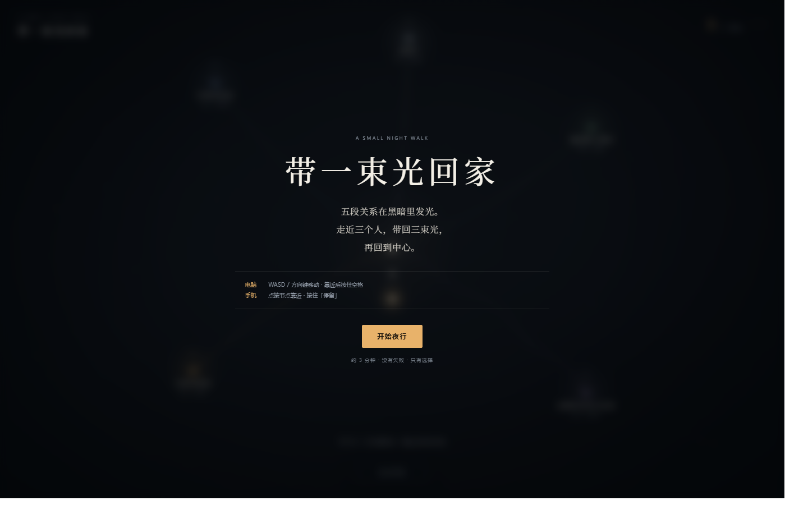
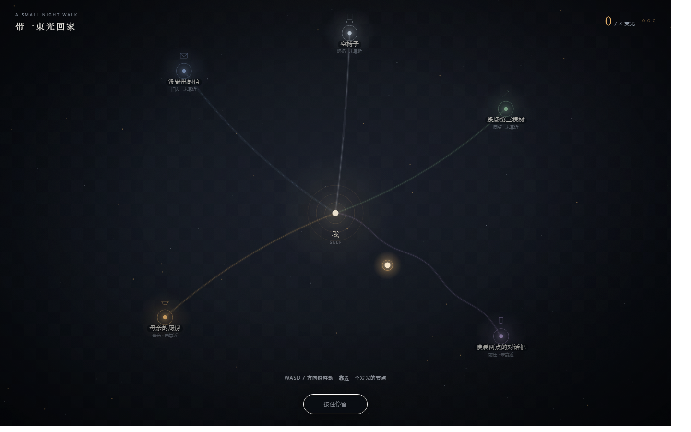
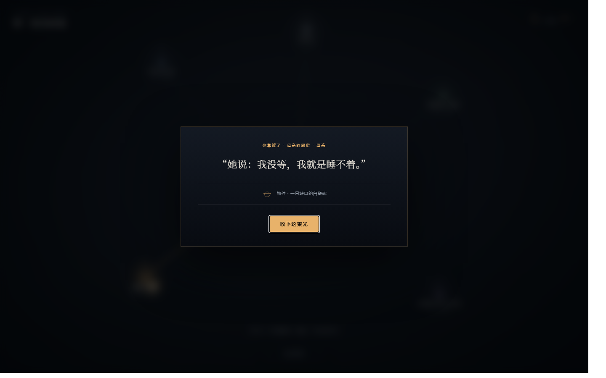
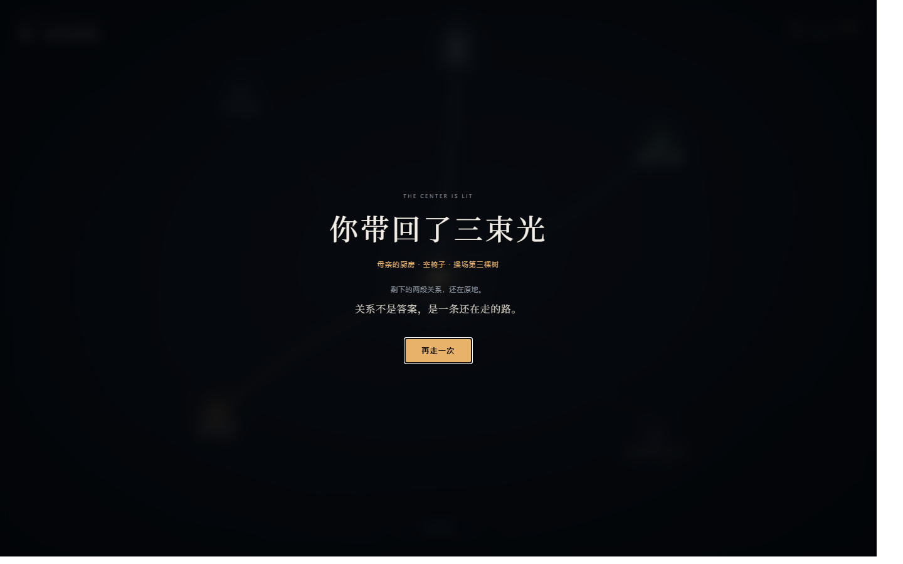

# 带一束光回家

从《关系地图 / 心理疗愈》延伸出来的一个交互小游戏。

五段关系在黑暗里发光。你是一束很小的人造光，从中心出发，走近三个人，按住停留，带回三束光，再回到中心。没有失败，只有选择。

**本地预览：** http://127.0.0.1:8767/  
**单文件版：** `bring-light-home.html`，双击即可打开。



---

## 怎么玩

- **电脑**：WASD / 方向键移动；靠近节点后按住空格；也可以点按节点自动走过去。
- **手机**：点按节点靠近；按住底部「停留」。
- 靠近一个节点 70px 内，按住停留 2 秒左右，会收下一句故事和一件旧物。
- 收集 3 束光后，其他节点会暗下去，中心亮起；回到中心，按住停留，把光放下。
- 没有失败、没有分数、没有倒计时。约 3 分钟。
- 每次只能带回 3 段关系，剩下的两段仍然留在原地。



## 五段关系

| 节点 | 关系 | 情绪色 | 旧物 |
|---|---|---|---|
| 母亲的厨房 | 母亲 | 暖琥珀 | 缺口的白瓷碗 |
| 没寄出的信 | 旧友 | 雾蓝 | 对折四次的信纸 |
| 操场第三棵树 | 同桌 | 苔绿 | 没有墨的黑笔 |
| 凌晨两点的对话框 | 前任 | 雾紫 | 碎角的旧手机 |
| 空椅子 | 奶奶 | 月白 | 磨亮的藤椅 |

每一段只有一句话、一个物件、一个停留动作——不是读完整故事，而是经过它。



## 设计意图

- **移动 = 主动靠近**：不是点开菜单，而是真的走过去。
- **按住 = 停留**：关系需要时间；松手就会慢慢退回。
- **只能带 3 束 = 选择**：你不可能同时照顾所有关系。
- **回到中心 = 收束**：光不是从别人那里拿走的，是你带回来照亮自己的。
- **没有失败**：走开、停下、再走一次，都是允许的。



## 文件

```
relationship-game/
├─ index.html        页面结构
├─ styles.css        视觉与响应式
├─ game.js           移动、靠近、停留、收集、结尾
├─ README.md
├─ bring-light-home.html   单文件版（CSS/JS 内联）
├─ preview-start.png
├─ preview-game.png
├─ preview-card.png
└─ preview-end.png
```

## 打开方式

**单文件**

双击 `bring-light-home.html`。

**多文件**

```bash
python -m http.server 8767
```

打开 `http://localhost:8767/`。

## 放到原作品里

这是一个独立小游戏，可以：

1. 单独部署成一个网址，作为《关系地图》的「游戏模式」。
2. 放到原站点的子目录 `game/`，在首页加一个「夜行模式」入口。
3. 把 `game.js` 里的 5 个节点替换成你自己的五段关系；每个节点只需要：
   ```js
   {
     id, name, relation, color, x, y,
     style: "solid | dashed | broken | tangled",
     icon: "bowl | letter | pen | phone | chair",
     object, whisper
   }
   ```

## 边界

- 这不是心理治疗，只是一个可以走一走的夜晚。
- 游戏不收集任何数据；没有后端、没有账号。
- 不设计「失败」「低分」「关系好坏」。
- 真实他人请化名、去掉可识别信息。
